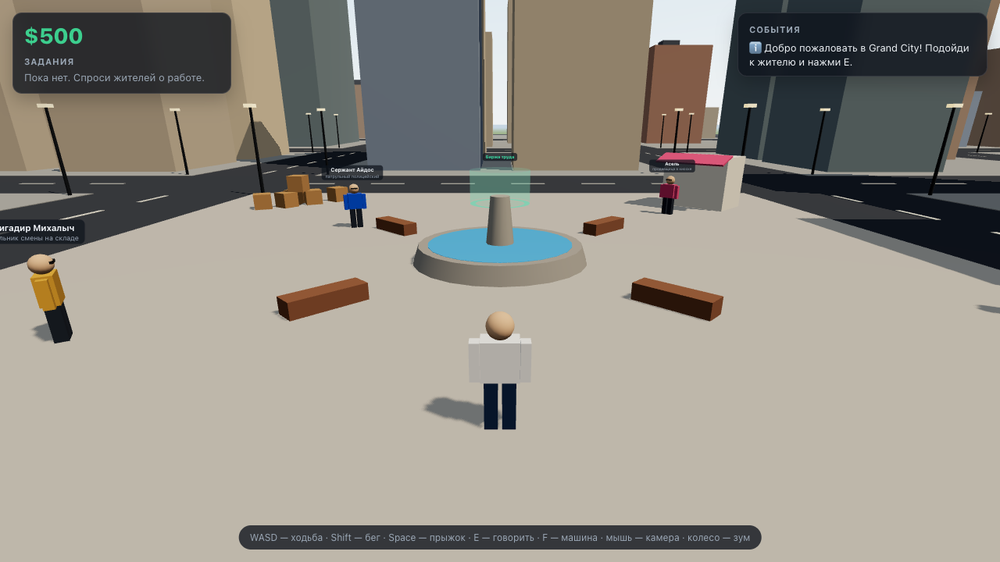
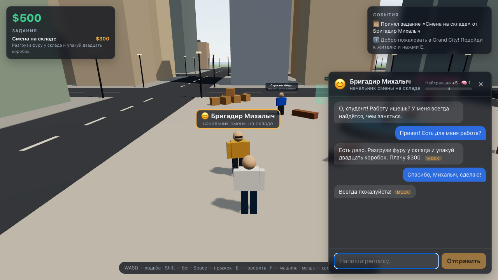
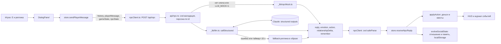

# Open City: стартовый шаблон 3D-игры с AI-NPC

Шаблон браузерной 3D-игры в духе мобильных RP-симуляторов жизни: процедурный город, персонаж на физике, аркадная машина и NPC, с которыми можно разговаривать через LLM (Claude). NPC возвращают структурированный JSON: реплику, эмоцию и игровое действие (выдать квест, дать или взять деньги). Ещё у них есть адаптивный слой: отношение к игроку и долгая память.

Здесь только переиспользуемый фундамент без логики конкретного кейса. Весь арт процедурный (боксы, цилиндры, инстансинг), поэтому шаблон работает офлайн и без API-ключа (mock-режим).




**Стек:** Vite 8 · React 19 · TypeScript 6 (strict) · @react-three/fiber 9 · drei 10 · @react-three/rapier 2 (Rapier 0.19) · three 0.186 · zustand 5 · zod 4 · @anthropic-ai/sdk 1.3.

## Быстрый старт

```bash
npm i
npm run dev          # http://localhost:5173: игра и API вместе
```

Без ключа сервер работает в **mock-режиме**: NPC отвечают детерминированными репликами в образе, включая квесты, деньги, изменение отношения и память. Чтобы подключить Claude:

```bash
cp .env.example .env.local   # вписать ANTHROPIC_API_KEY
npm run smoke:llm            # один реальный запрос: модель, задержка, JSON
npm run dev
```

В диалоге у ответов, которые пришли не от LLM, стоит бейдж `mock` или `fallback`.

### Управление

| Действие | Клавиатура | Телефон |
| --- | --- | --- |
| Ходьба / бег | WASD или стрелки, Shift | джойстик (до упора = бег) |
| Прыжок | Space | ⤒ |
| Поговорить с NPC (ближе 3 м) | E | E |
| Сесть в машину / выйти | F | F |
| Газ, тормоз, руль, ручник | W/S, A/D, Space | джойстик, ⤒ |
| Камера | зажать мышь и вести, колесо = зум | свайп по экрану |
| Закрыть диалог | Esc | × |

Клавиши привязаны к `KeyboardEvent.code`, поэтому WASD работает и в русской раскладке. `?touch` в URL включает сенсорный интерфейс на десктопе, `?debug` показывает коллайдеры и FPS.

## Переменные окружения

Их читает только сервер (`api/` и dev-сервер). В клиентский бандл они не попадают: Vite отдаёт клиенту только переменные с префиксом `VITE_`. Ключ так называть **нельзя**.

| Переменная | По умолчанию | Назначение |
| --- | --- | --- |
| `ANTHROPIC_API_KEY` | (пусто) | Ключ Anthropic. Пусто — mock-режим |
| `LLM_MODEL` | `claude-haiku-5-5` | Модель для диалогов. Haiku выбран из-за низкой задержки |
| `LLM_MOCK` | `0` | `1` — mock-режим даже при наличии ключа |

## Скрипты

| Команда | Что делает |
| --- | --- |
| `npm run dev` | Vite dev-сервер с API-маршрутами из `api/` |
| `npm run build` | `typecheck` + production-сборка в `dist/` |
| `npm run preview` | Раздача собранного `dist/` (только фронтенд, без API) |
| `npm run typecheck` | `tsc -p src` (браузер) и `tsc -p .` (сервер, NodeNext) |
| `npm run smoke:llm` | Один реальный вызов Claude через `api/_lib/llm.ts` с промптом и схемой NPC |

## Архитектура



- **Контракт.** Он один, в `src/ai/protocol.ts`, и написан на zod. По нему сервер валидирует запрос, по нему же строится схема structured output для модели (`NpcReplySchema`), и по нему клиент проверяет ответ.
- **Деградация.** Ни один сбой не ломает игру. Если LLM недоступна, ответила невалидно, отказалась отвечать или не уложилась в 15 с, сервер возвращает реплику в образе (`source: "fallback"`). Если упала сеть или пришёл кривой ответ, клиент делает то же самое. Структурированный вывод гарантирует форму JSON, но значения enum и диапазоны чисел для API лишь подсказки. Поэтому у отдельных полей стоит `.catch()` (неизвестная эмоция становится `neutral`, кривое действие — `none`), а числа ограничиваются правилами игры в сторе.
- **Безопасность.** Персону NPC сервер берёт по `npcId` из `src/game/npcs.ts`, клиент не может подсунуть свой системный промпт. Системный промпт зависит только от NPC и не меняется между репликами, поэтому его можно кешировать. Всё изменчивое (деньги, квесты, память, события) идёт в последнее сообщение пользователя.
- **Состояние.** Игровое состояние лежит в zustand (`src/state/store.ts`). Всё покадровое (позиции, углы камеры) хранится в `src/game/runtime.ts` вне React, чтобы ничего не перерисовывалось 60 раз в секунду.
- **Производительность.** Каждый тип объектов города — один `InstancedMesh`, все статические коллайдеры — одно fixed-тело. Сцена целиком занимает около 100 draw calls за кадр, включая тени. Солнце едет за камерой, поэтому теневой карты 2048² хватает на видимую область.

### Структура

```
api/                      Vercel Functions (Node.js runtime)
  npc.ts                  POST /api/npc: одна реплика NPC
  _lib/llm.ts             callStructured(): Claude + structured outputs, таймаут, ошибки, mock-флаг
  _lib/npcPrompt.ts       системный промпт и контекст NPC, fallback-реплика
  _lib/npcMock.ts         детерминированные ответы без ключа
  _lib/http.ts            json(), readJsonBody()
dev/apiDevPlugin.ts       Vite-плагин: /api/* → api/*.ts в dev, переменные из .env.local
scripts/smokeLlm.ts       npm run smoke:llm
src/
  ai/protocol.ts          zod-контракт клиент ↔ сервер (общий файл)
  ai/npcClient.ts         запрос к /api/npc, валидация, fallback
  state/store.ts          zustand: деньги, квесты, журнал, отношения, диалоги и правила игры
  state/persistence.ts    сохранение памяти NPC в localStorage
  game/GameScene.tsx      Canvas, Physics, состав сцены
  game/city.ts            процедурный город (seed → одинаковый город)
  game/World.tsx          инстансинг города и коллайдеры
  game/Props.tsx          площадь: фонтан, киоск, лавки, ящики с физикой
  game/Lighting.tsx       небо, туман, солнце с тенями
  game/Player.tsx         капсула Rapier: ходьба, бег, прыжок
  game/FollowCamera.tsx   камера от третьего лица, не проходит сквозь стены
  game/Car.tsx            аркадная машина
  game/npcs.ts, Npc.tsx   данные NPC и их отрисовка
  game/zones.ts, TriggerZone.tsx  зоны-триггеры
  game/Interactions.tsx   близость к NPC и машине, действия E / F / Esc
  game/controls.ts        клавиатура и сенсорный ввод
  game/runtime.ts         покадровое состояние вне React
  game/config.ts          настройки геймплея
  ui/                     Hud, DialogPanel, InteractionPrompt, TouchControls
```

## Адаптивные NPC: отношение и память

NPC «учатся» на поведении игрока через три источника контекста:

1. **Журнал событий.** `recordEvent(type, text)` в сторе хранит последние 20 событий: сел в машину, получил или потратил деньги, принял квест, поговорил с NPC, зашёл в зону. Последние 10 (кроме системных) уходят в каждый запрос как `gameState.recentEvents` с полем `secondsAgo`. Поэтому NPC может отреагировать на то, что игрок сделал в другом месте. Эти же события показывает HUD.
2. **Отношение.** `npcStates[npcId].relationship` от −100 до 100, в начале 0. Шкала видна в шапке диалога.
3. **Память.** `npcStates[npcId].memories` — до 8 коротких фактов об игроке. Наведи курсор на шкалу, чтобы увидеть, что NPC помнит.

Поток данных. Клиент отправляет `npcState` вместе с репликой. Сервер кладёт его в блоки `<npc_memory>` и `<world_events>` последнего сообщения. Модель возвращает `relationshipDelta` (целое, −10…10) и `remember` (0–2 факта). Клиент валидирует их zod-схемой, а `evolveSocialState` в `store.ts` применяет правила: обрезает дельту до ±10 и итог до ±100, берёт максимум 2 факта по 120 символов, убирает повторы и хранит 8 последних. `npcStates` сохраняется в `localStorage` под ключом `web-game-3d/npc-state/v1`: запись в try/catch, при чтении проверка zod-схемой. Диалоговая история (короткая память) живёт только в текущей сессии.

Где расширять:

- **Новые события.** Тип добавляется в `GameEventType`, `recordEvent(...)` вызывается там, где событие случается.
- **Влияние отношения на геймплей.** Скидки, отказ выдавать квест и т. п. делаются в `applyAction` или правилами в `api/_lib/npcPrompt.ts`.
- **Сжатие памяти.** Когда фактов больше 8, их можно суммаризировать отдельным AI-эндпоинтом в `evolveSocialState`.
- **Память на сервере.** Чтобы память была общей для устройств и игроков, `src/state/persistence.ts` заменяется на серверное хранилище (KV или Postgres).
- **Сброс.** `localStorage.removeItem('web-game-3d/npc-state/v1')` в консоли браузера.

## Рецепты

### Добавить NPC

Достаточно одной записи в `src/game/npcs.ts`, остальной код менять не нужно:

```ts
{
  id: 'miner',
  name: 'Шахтёр Ержан',
  role: 'бригадир на шахте',
  persona: 'Немногословный, уставший, но надёжный. Нанимает на смены в шахту, платит за выработку.',
  greeting: 'Каска есть? Без каски в забой не пущу.',
  position: [-12, 0, -2],   // центральная площадь: |x|, |z| < 15
  facing: 1.2,
  color: '#7c8a99',
  sampleQuest: { title: 'Смена в забое', description: 'Добудь 10 тонн руды.', reward: 400 },
},
```

Город детерминирован (seed в `src/game/city.ts`). Свободные места — центральная площадь и дороги, их центры лежат на `x` или `z` = ±20, ±60, ±100. Проверить, что NPC не стоит в здании, помогает `?debug`.

### Добавить тип действия (пример: `complete_quest`)

1. `src/ai/protocol.ts`: добавить вариант в `GameActionSchema`:
   ```ts
   z.object({ type: z.literal('complete_quest'), payload: z.object({ title: z.string() }) }),
   ```
2. `src/state/store.ts`: добавить обработку в `applyAction`. Пока её нет, TypeScript не соберёт проект (`assertNever`):
   ```ts
   case 'complete_quest': {
     const quest = get().quests.find((q) => q.giverNpcId === npcId && q.title === action.payload.title);
     if (!quest) return;
     set((s) => ({ quests: s.quests.filter((q) => q !== quest), money: s.money + quest.reward }));
     get().recordEvent('quest', `Выполнил «${quest.title}»: +$${quest.reward}`);
     return;
   }
   ```
3. `api/_lib/npcPrompt.ts`: объяснить модели, когда использовать действие.
4. Необязательно: правило в `api/_lib/npcMock.ts`, чтобы действие работало и в mock-режиме.

### Добавить AI-эндпоинт (пример: генератор квестов)

Новый файл `api/quest.ts` автоматически становится `POST /api/quest` и в dev, и на Vercel. В `api/` относительные импорты пишутся с `.js`, этого требует нативный ESM, а `tsc -p .` это проверяет.

```ts
import { z } from 'zod';
import { json, readJsonBody } from './_lib/http.js';
import { callStructured, isMockMode, LlmError } from './_lib/llm.js';

const QuestSchema = z.object({
  title: z.string(),
  steps: z.array(z.string()).describe('2-4 short steps'),
  reward: z.number().int(),
});

export async function POST(request: Request): Promise<Response> {
  const input = z.object({ theme: z.string().min(1).max(200) }).safeParse(await readJsonBody(request));
  if (!input.success) return json({ error: 'Invalid request body' }, 400);
  if (isMockMode()) return json({ title: 'Доставка', steps: ['Забери груз', 'Отвези в порт'], reward: 200 });

  try {
    const { data } = await callStructured({
      system: 'You design short quests for a GTA-style role-play game. Write in Russian.',
      messages: [{ role: 'user', content: `Тема квеста: ${input.data.theme}` }],
      schema: QuestSchema,
      effort: 'medium',
    });
    return json(data);
  } catch (error) {
    return json({ error: error instanceof LlmError ? error.kind : 'unknown' }, 502);
  }
}
```

`callStructured` принимает необязательные `model`, `effort` (`low` по умолчанию), `maxTokens` и `timeoutMs`. Он возвращает `{ data, model, latencyMs, usage }` и бросает `LlmError` с полем `kind`: `timeout`, `rate_limit`, `auth`, `refusal`, `invalid_output` и т. д.

### Добавить триггер-зону

Через данные: запись в `src/game/zones.ts`. При входе игрока пишется событие, которое увидят NPC:

```ts
{ id: 'mine', label: 'Шахта', position: [-20, 0, 20], radius: 3, color: '#ffb547',
  event: { type: 'zone', text: 'Пришёл на шахту' } },
```

С собственной логикой: компонент `<TriggerZone>` с `onEnter` / `onExit`. Это Rapier-сенсор, который реагирует только на игрока пешком:

```tsx
<TriggerZone position={[20, 0, -20]} radius={2} color="#3ccf8e" label="Банкомат"
  onEnter={() => useGameStore.getState().applyAction(
    { type: 'give_money', payload: { amount: 100, reason: 'Зарплата' } }, 'foreman')} />
```

## Деплой на Vercel

`vercel.json` не нужен. Vercel сам определяет Vite: `npm run build` собирает в `dist/`, файлы из `api/` становятся Node.js-функциями, а `api/_lib/` в функции не превращается (префикс `_`).

```bash
npm i -g vercel
vercel                              # привязать проект и задеплоить preview
vercel env add ANTHROPIC_API_KEY    # отметить Production и Preview
vercel env add LLM_MODEL            # по желанию
vercel --prod
```

Ключ можно задать и в дашборде: Project → Settings → Environment Variables. После изменения переменных нужен повторный деплой. Если ключа нет, прод работает в mock-режиме.

TypeScript закреплён на 6.0, а не на 7.0: нативный TS 7 поставляется без JS-API компилятора, которым `@vercel/node` собирает функции из `api/`.

## Известные ограничения

- Шаблон проверен локально (`typecheck`, `build`, curl к `/api/npc`, headless-рендер и диалог в Playwright). На Vercel он **не деплоился**, `vercel dev` не запускался.
- Реальный вызов Claude при подготовке не делался, ключа не было. LLM-путь проверен на локальном фейковом Anthropic-эндпоинте: форма запроса, разбор ответа, отказ модели, невалидный JSON, таймаут 15 с. Ключ стоит проверить через `npm run smoke:llm`.
- Состояние авторитетно на клиенте: деньги, квесты и отношения живут в браузере. На `/api/npc` нет авторизации и rate limit, любой, кто знает URL, может тратить токены. Для продакшена нужны серверное состояние и лимиты (Vercel Firewall, токен).
- Квесты нельзя завершить: действия `complete_quest` нет, пример выше. NPC стоят на месте (нет навигации и трафика) и не разговаривают друг с другом.
- Машина аркадная, без симуляции колёс, и она одна. Вращение разрешено только вокруг вертикальной оси, перевернуться нельзя.
- Mock-режим понимает только ключевые слова на русском и английском, он нужен для демо без ключа.
- Таблички с именами (drei `Html`) видны сквозь здания.
- Чанк физики (Rapier WASM внутри JS) весит около 2,2 МБ, 840 КБ в gzip. Первая загрузка занимает пару секунд, пока висит «Загружаем город…».
- В консоли два предупреждения из библиотек: `THREE.Clock` deprecated (R3F) и устаревшие параметры инициализации Rapier (`@react-three/rapier`). На работу они не влияют.
- Сенсорное управление проверено в эмуляции мобильного Chromium, на реальных телефонах не проверялось.
- В dev доступен `window.__game` (`store`, `teleport(x, z)`) для отладки и автотестов. В production-сборку он не попадает.
